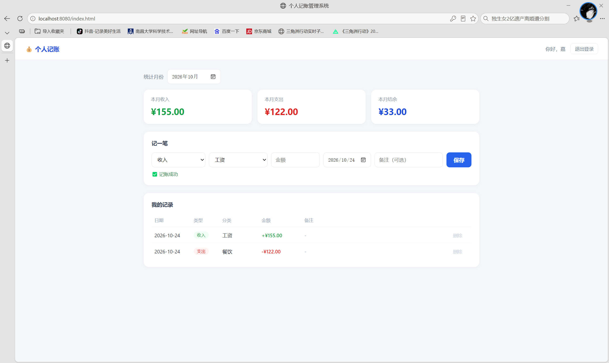
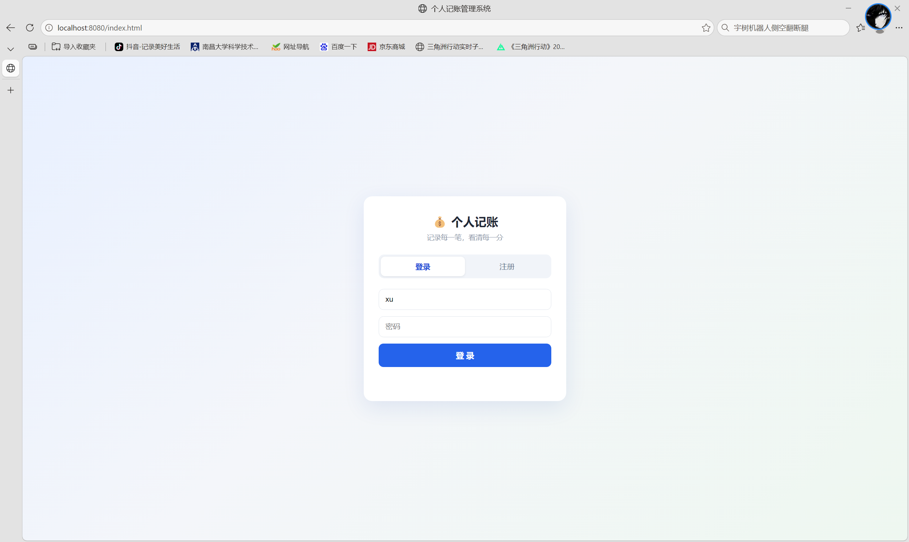

# 个人记账管理系统

基于 Spring Boot + MyBatis + MySQL 的个人收支记账系统，支持注册登录、收支记录增删改查、月度统计，并接入大模型实现「一句话记账」。

## 界面预览

| 主界面（统计 + AI 记账 + 记录列表） | 登录页 |
|---|---|
|  |  |

## 技术栈

| 层次 | 技术 |
|---|---|
| 语言 | Java 17 |
| 框架 | Spring Boot 4.0.9、Spring MVC、MyBatis |
| 数据库 | MySQL 8.0（utf8mb4） |
| 构建 | Maven |
| 前端 | 原生 HTML/CSS/JavaScript（fetch API） |
| AI | 智谱 GLM-4-Flash（OpenAI 兼容协议，JDK HttpClient 调用） |
| 序列化 / 测试 | Jackson 3、JUnit 5 |

## 功能特性

- **用户模块**：注册（用户名查重、MD5 密码加密）、登录（凭证校验、统一错误提示防账号枚举）
- **登录鉴权**：HMAC-SHA256 签名 Token + 拦截器，`userId` 由 Token 解析，接口不再接收前端传入的用户标识
- **记账模块**：新增 / 查询列表 / 修改 / 删除 / 按月统计，前端支持点「编辑」回填改账
- **参数校验**：`@Valid` + Jakarta Validation 注解声明式校验（非空、长度、金额>0、类型枚举），错误统一 400 返回
- **AI 一句话记账**：输入「昨天午饭38块」，大模型解析为结构化 JSON 后自动落库
- **数据安全**：所有读写 SQL 强制携带 `user_id` 条件实现数据权限隔离，越权修改/删除实测被拦截；金额使用 `BigDecimal` 避免精度丢失
- **异常处理**：`@RestControllerAdvice` 全局兜底，统一 `code-msg` 响应，内部堆栈只记录日志不外泄
- **代码分层**：Controller（收参/返响应）→ Service（业务校验、加密、权限）→ Mapper（SQL）
- **前端页面**：纯静态页面随 jar 一起部署，同源调用接口，`localStorage` 保存登录态

## 项目结构

```
src/main/java/com/jzbook/accountbook/
├── AccountBookApplication.java     启动类
├── HelloController.java            用户接口（/register、/login）
├── RecordController.java           记账接口（/record/*）
├── AiController.java               AI 记账接口（/ai/*）
├── common/Result.java              统一响应结构
├── config/WebConfig.java           拦截器注册
├── security/
│   ├── TokenService.java           HMAC-SHA256 签名 Token
│   └── AuthInterceptor.java        登录拦截器（userId 注入）
├── dto/                            请求体 + 参数校验注解
├── entity/
│   ├── User.java
│   └── Record.java
├── service/
│   ├── UserService.java / RecordService.java / AiService.java
│   └── impl/                       业务实现（校验、MD5、Prompt 组装、解析）
├── exception/
│   ├── GlobalExceptionHandler.java 全局异常处理
│   └── AuthException.java          登录失败（401）
└── mapper/
    ├── UserMapper.java
    └── RecordMapper.java

src/main/resources/
├── application.properties          数据库、MyBatis、AI、Token 配置
├── db/schema.sql                   建表脚本
└── static/index.html               前端页面（单页）

docs/api-test.http                  接口测试用例（含 Token 自动提取）
```

## 鉴权设计

- 登录/注册成功后签发 **HMAC-SHA256 签名 Token**（格式：`base64(userId:过期时间).签名`），前端存 localStorage
- 业务接口（`/record/**`、`/ai/**`）由 `AuthInterceptor` 统一校验 `Authorization: Bearer <token>`
- **userId 一律从 Token 解析**，接口不再接收前端传入的 userId —— 从根源上消除越权读写
- 签名比较使用 `MessageDigest.isEqual`（定长时间比较，防时序攻击）；密钥通过环境变量 `APP_TOKEN_SECRET` 注入
- 校验失败返回真实 HTTP 401 + `{"code":401,"msg":"未登录或登录已过期"}`，前端捕获后自动退出登录

## 接口文档

除注册、登录、健康检查外，所有接口都需在请求头带 `Authorization: Bearer <token>`。

| 方法 | 路径 | 说明 |
|---|---|---|
| POST | /register | 注册（username、password、nickname），返回 token |
| POST | /login | 登录，返回 userId、nickname、token |
| POST | /record/add | 新增记录（type、category、amount、recordDate、remark） |
| GET | /record/list | 查询当前用户全部记录（userId 取自 Token） |
| POST | /record/update | 修改记录（id + 记录字段） |
| POST | /record/delete | 删除记录（id） |
| GET | /record/summary?month= | 按月统计（month 格式 yyyy-MM） |
| POST | /ai/record | 一句话记账（text） |
| GET | /ai/config-check | 大模型配置自检（不返回密钥内容） |

统一响应格式：

```json
{ "code": 0, "msg": "成功", "data": {} }
```

`code` 约定：0 成功、400 参数错误、401 未认证、404 资源不存在、500 系统异常。
参数校验由 `@Valid` + Jakarta Validation 注解完成，错误信息统一由 `GlobalExceptionHandler` 返回，例如：

```json
{ "code": 400, "msg": "金额必须大于 0", "data": null }
```

## AI 一句话记账的实现要点

1. **Prompt 约束输出**：system prompt 限定 JSON 字段、分类枚举取值范围、非记账语句的兜底格式
2. **结构化输出**：请求体带 `response_format: json_object`，避免模型返回带解释文字的文本
3. **不信任模型输出**：解析后再做二次校验（type ∈ {1,2}、amount > 0、日期不越界、分类兜底「其他」），失败返回业务提示而非 500
4. **精确计算交给代码**：模型只输出相对天数 `dayOffset`（今天=0、昨天=-1），真实日期由 `LocalDate.now().plusDays()` 换算——实测模型直接算日期会算错
5. **密钥安全**：密钥存放在本地 `ai-local.properties`（已加入 `.gitignore`），不进代码仓库，并做 BOM / 空格 / 引号清理

## 数据库设计

**t_user**：id、username（唯一）、password（MD5）、nickname、create_time

**t_record**：id、user_id、type（1支出/2收入）、category、amount（DECIMAL 10,2）、record_date、remark、create_time

索引：`idx_user_date (user_id, record_date)` —— 支撑"按用户 + 按日期"的列表查询与月度统计。

建表脚本：`src/main/resources/db/schema.sql`

## 本地运行

1. 启动 MySQL，创建数据库并执行 `schema.sql`
2. 修改 `application.properties` 中的数据库账号密码
3. 使用 AI 功能需在项目根目录新建 `ai-local.properties`，内容为 `ai.api-key=你的智谱密钥`
4. 运行 `AccountBookApplication`
5. 浏览器访问 `http://localhost:8080`

## 测试

使用 JUnit 5 + Spring Boot Test 编写数据访问层单元测试（`src/test/java/.../MapperTest.java`），4 个用例全部通过：

| 测试用例 | 验证内容 |
|---|---|
| insertThenFindByUsername | 插入用户后能按用户名正确查出 |
| findByUsernameReturnsNullWhenNotExist | 查询不存在的用户返回 null |
| insertRecordThenListAndSummary | 新增记录后列表可查、月度统计正确返回 |
| deleteOthersRecordShouldFail | 越权删除影响 0 行，本人删除成功 |

测试类使用 `@Transactional`，每个用例执行完自动回滚，不污染数据库。

## 后续计划

- [x] Controller–Service–Mapper 分层重构
- [x] UPDATE 接口与前端编辑
- [x] 全局异常处理
- [x] Token 登录态与接口鉴权
- [x] 参数校验与统一响应结构
- [x] AI 一句话记账（大模型接入）
- [ ] 接口层自动化测试（MockMvc）
- [ ] 部署至云服务器

## License

本项目基于 [MIT](LICENSE) 协议开源。
